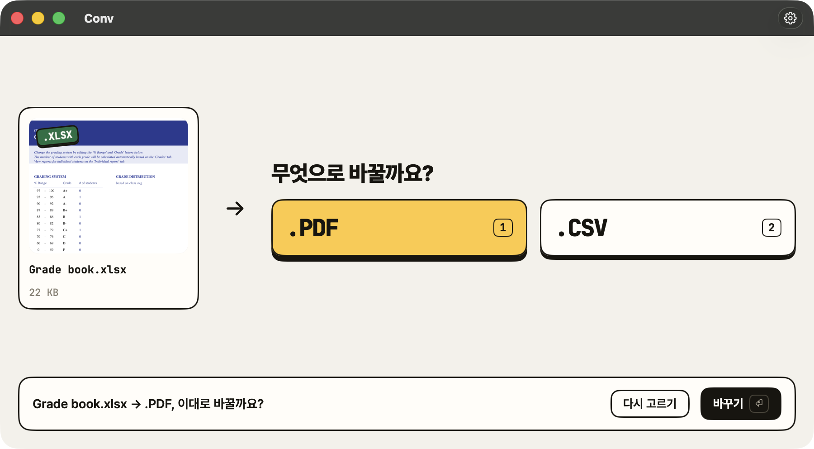
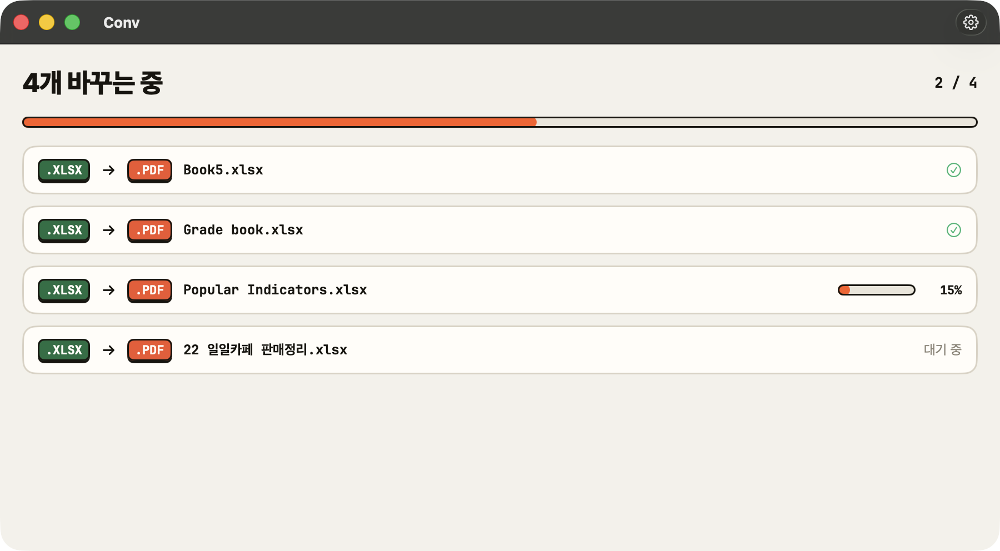
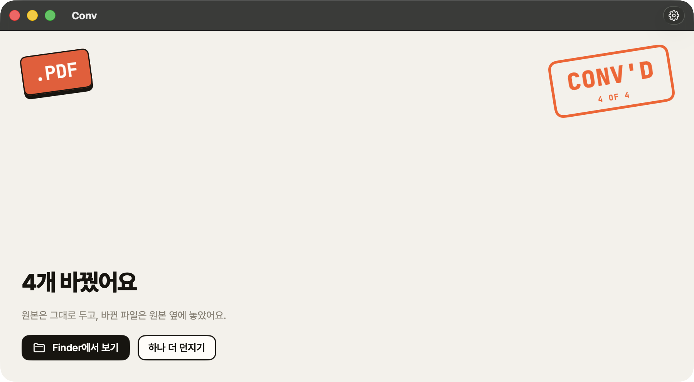
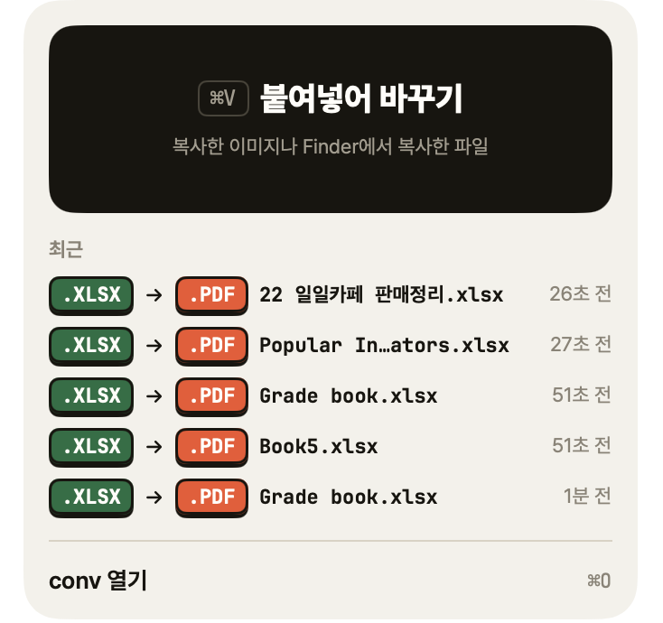
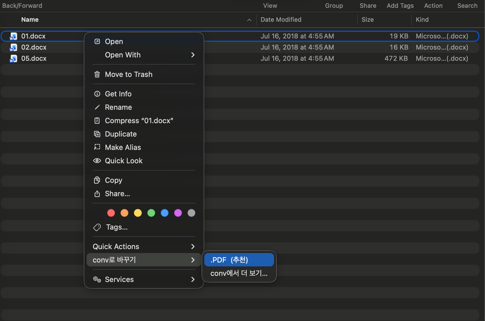
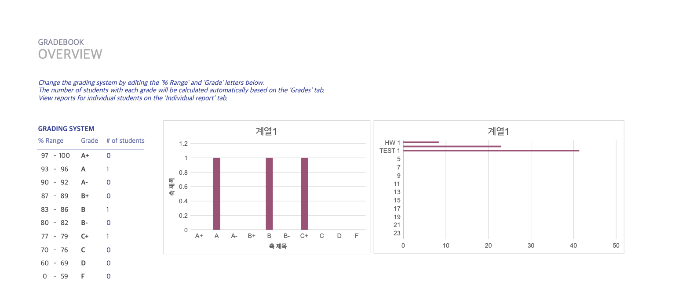

<p align="center">
  
</p>

<h1 align="center">Conv</h1>

<p align="center">
  Drop a file, pick a format, done. A file converter for the Mac.<br>
  Works from the menu bar, and even from Finder's right-click menu.
</p>

<p align="center">
  
</p>

Conv speaks English and Korean, following your Mac's language.

## Features

- **Drop, pick, done.** Drag files onto the window, press a number key to pick a format, then Return. The converted file is saved next to the original, which is left untouched.
- **Korean documents, faithfully.** HWP and HWPX become PDF or Word (DOCX), keeping tables, pictures, headers and footers, footnotes and equations.
- **Excel, printed the way Excel prints.** XLSX to PDF honors print areas, repeated title rows, page breaks and fit-to-page, and redraws charts, pictures and shapes.
- **Many files at once.** Drop a batch and convert it in one go, or combine several images and PDFs into one PDF.
- **Right from Finder.** Right-click a file and convert it without opening the window.
- **Paste from the menu bar.** Copy an image, or a file in Finder, and press ⌘V in the menu bar popover.
- **Nothing leaves your Mac.** Every conversion runs locally, in a sandboxed process separate from the app. Files are never uploaded.

## Screenshots

| Drop files | Converting |
| --- | --- |
|  |  |

| Done | Menu bar |
| --- | --- |
|  |  |

**Finder:** convert from the right-click menu.



**XLSX → PDF:** charts are redrawn the way Excel draws them.



## Supported formats

| From | To |
| --- | --- |
| HWP, HWPX | PDF, DOCX |
| DOCX | PDF |
| XLSX | PDF, CSV |
| CSV | XLSX (encoding detected, including CP949, so Korean opens unbroken in Excel) |
| PDF | JPG or PNG, one per page |
| Markdown | PDF, HTML |
| SVG | PNG, JPG, PDF |
| Images (HEIC, JPG, PNG, WebP, TIFF, GIF, BMP, AVIF) | JPG, PNG, PDF, HEIC, TIFF, GIF, BMP, AVIF |
| Video (MOV, MP4, M4V) | MP4, MOV, M4A, MP3, GIF |
| Audio (M4A, MP3, WAV, AIFF, CAF, AAC, FLAC) | MP3, M4A, WAV, AIFF |
| Several images or PDFs | One combined PDF |

## Install

Requires macOS 14 Sonoma or later.

### Build from source

The project is generated with [Tuist](https://tuist.dev). With [mise](https://mise.jdx.dev), the right Tuist version installs itself.

```sh
git clone https://github.com/hwan-cs/Conv.git
cd Conv
mise install          # or install Tuist 4.x yourself
tuist install
tuist generate
```

Then run the `Conv` scheme in the generated `Conv.xcworkspace`.

`./scripts/make-dmg.sh` builds a Release copy signed with your Developer ID and packs it into `dist/Conv.dmg`. It needs a Developer ID Application certificate in your keychain.

### Finder menu

After installing, turn on Conv under **System Settings › General › Login Items & Extensions › Finder**, then allow the folders you want to convert in, in Conv's settings. Conversions started from Finder run in the background and save next to the original, so Conv needs permission to write there.

## Architecture

The app is split into Tuist modules:

```
Projects/
├── App/            The app, the conversion XPC service and the Finder extension
├── Features/       DropFeature (main window), MenuBarFeature, SettingsFeature
├── Core/           ConversionKit (formats and jobs), DesignSystem, Platform
└── Engines/        Converters
    ├── DocumentEngine  HWP, DOCX, Markdown, XLSX, CSV → PDF, DOCX, HTML, XLSX, CSV
    ├── PDFEngine       PDF → images, combining PDFs
    ├── ImageEngine     Images and SVG
    └── MediaEngine     Video and audio, GIF, MP3 (LAME)
```

Conversions run in a sandboxed XPC service, so a malformed file can crash a converter without taking the app down.

## License

[MIT](LICENSE)

Bundled third-party code and fonts, whose notices are also shown in the app under Settings › Open Source Licenses:

- [LAME](https://lame.sourceforge.io) 3.100 (LGPL 2, linked as a dynamic library)
- [ZIPFoundation](https://github.com/weichsel/ZIPFoundation) (MIT)
- [swift-markdown](https://github.com/swiftlang/swift-markdown) (Apache 2.0) and cmark-gfm (BSD 2-Clause)
- [Pretendard](https://github.com/orioncactus/pretendard), [JetBrains Mono](https://www.jetbrains.com/lp/mono/), Nanum Gothic and Nanum Myeongjo (SIL Open Font License 1.1)
